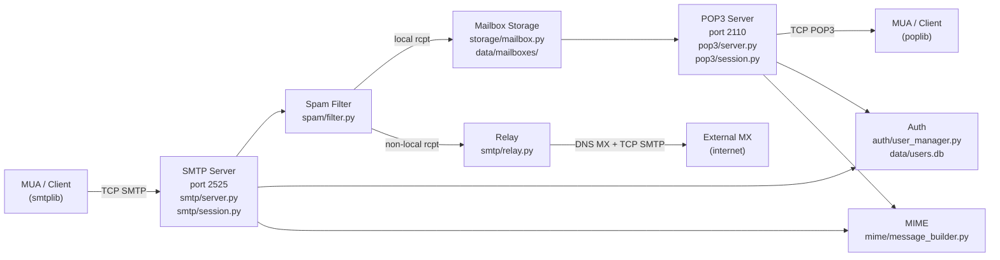
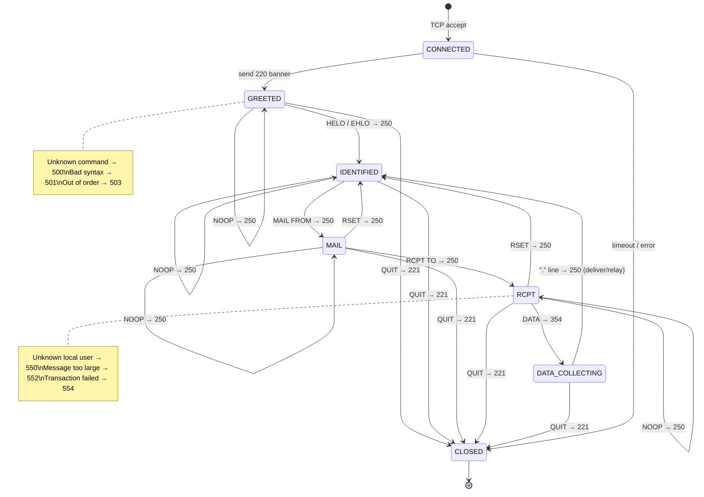
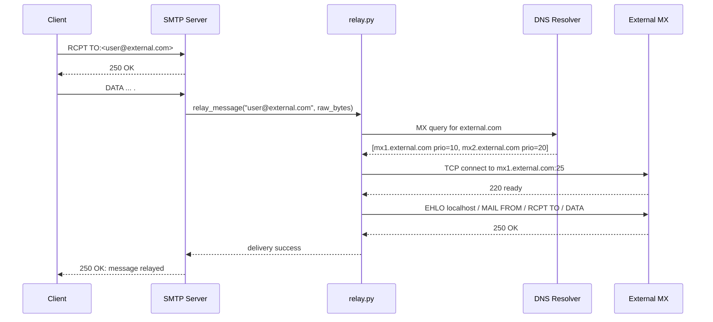
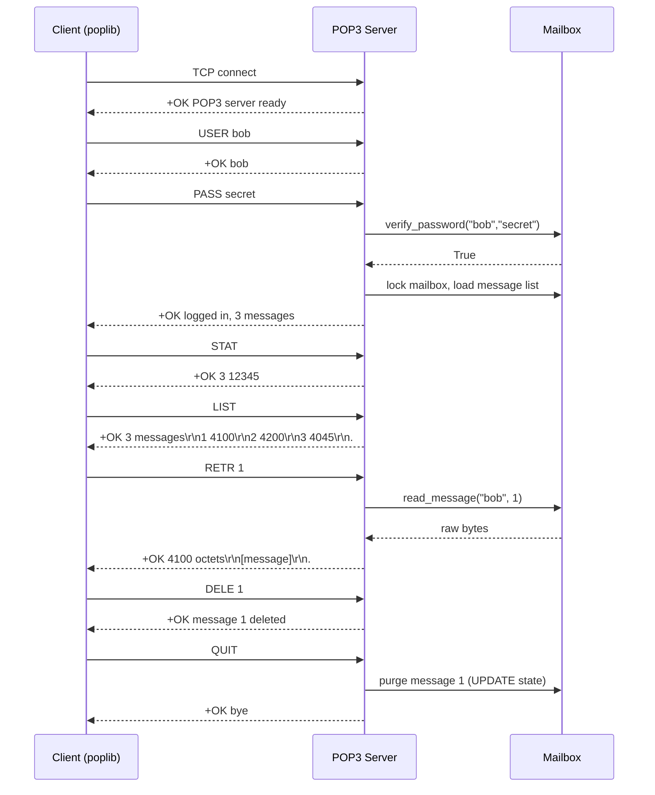

# Architecture — mini-mail-system

---

## 1. High-Level Architecture



---

## 2. Component Descriptions

### 2.1 `config/settings.py`

| Attribute | Value |
|-----------|-------|
| **Responsibility** | Single source of truth for all runtime configuration. Reads environment variables and provides typed defaults. |
| **Inputs** | Environment variables (or `.env` file loaded externally). |
| **Outputs** | A `Settings` dataclass instance imported by all other modules. |
| **Dependencies** | `os`, `pathlib`. No other mailsys modules. |

### 2.2 `common/logger.py`

| Attribute | Value |
|-----------|-------|
| **Responsibility** | Configure a named logger with a `StreamHandler` and a `RotatingFileHandler` pointing to `data/logs/`. |
| **Inputs** | Logger name string, log level from `Settings`. |
| **Outputs** | A configured `logging.Logger` instance. |
| **Dependencies** | `settings.py`, stdlib `logging`. |

### 2.3 `common/protocol_utils.py`

| Attribute | Value |
|-----------|-------|
| **Responsibility** | Provide low-level helpers: CRLF-terminated line reading from a socket, and RFC-formatted reply/response sending. |
| **Inputs** | A connected `socket.socket` object. |
| **Outputs** | Decoded string lines; sends bytes over socket. |
| **Dependencies** | `socket` stdlib only. |

### 2.4 `auth/user_manager.py`

| Attribute | Value |
|-----------|-------|
| **Responsibility** | Create user accounts, verify passwords, and check user existence against the SQLite database. |
| **Inputs** | Username string, plain-text password string. |
| **Outputs** | Boolean results; raises exceptions on DB errors. |
| **Dependencies** | `sqlite3`, `hashlib`, `os`, `settings.py`. |

### 2.5 `storage/mailbox.py`

| Attribute | Value |
|-----------|-------|
| **Responsibility** | Deliver messages to a user's Maildir, list messages, read a message by index, delete messages, and generate stable UIDs for POP3 UIDL. |
| **Inputs** | Username, message bytes (raw `.eml`). |
| **Outputs** | File paths, message bytes, UID strings, message lists. |
| **Dependencies** | `pathlib`, `threading` (per-mailbox lock), `hashlib` (UID), `settings.py`. |

### 2.6 `smtp/server.py`

| Attribute | Value |
|-----------|-------|
| **Responsibility** | Bind a TCP socket to `SMTP_PORT`, accept connections in a loop, and spawn a daemon thread running `SMTPSession` per connection. |
| **Inputs** | Settings (host, port). |
| **Outputs** | Spawns threads; logs accept events. |
| **Dependencies** | `socket`, `threading`, `smtp/session.py`, `settings.py`, `logger.py`. |

### 2.7 `smtp/session.py`

| Attribute | Value |
|-----------|-------|
| **Responsibility** | Implement the full SMTP server-side state machine for a single client connection: greet, parse commands, validate state transitions, collect DATA with dot-unstuffing, invoke spam filter, and hand off to `mailbox.py` or `relay.py`. |
| **Inputs** | Connected `socket.socket`, peer address. |
| **Outputs** | Messages stored or relayed; replies sent over socket. |
| **Dependencies** | `protocol_utils`, `auth/user_manager`, `storage/mailbox`, `spam/filter`, `smtp/relay`, `mime/message_builder`. |

### 2.8 `smtp/relay.py`

| Attribute | Value |
|-----------|-------|
| **Responsibility** | Look up the MX records for a domain via DNS and deliver a message by opening an outbound SMTP connection using `smtplib`. |
| **Inputs** | Recipient email address, message bytes. |
| **Outputs** | Delivery success/failure; logs result. |
| **Dependencies** | `dns.resolver` (dnspython), `smtplib`, `settings.py`, `logger.py`. |

### 2.9 `pop3/server.py`

| Attribute | Value |
|-----------|-------|
| **Responsibility** | Bind TCP socket to `POP3_PORT`, accept connections, spawn daemon thread per connection running `POP3Session`. |
| **Inputs** | Settings (host, port). |
| **Outputs** | Spawns threads; logs accept events. |
| **Dependencies** | `socket`, `threading`, `pop3/session.py`, `settings.py`, `logger.py`. |

### 2.10 `pop3/session.py`

| Attribute | Value |
|-----------|-------|
| **Responsibility** | Implement the full POP3 server-side state machine: AUTHORIZATION (USER/PASS), TRANSACTION (STAT/LIST/RETR/DELE/UIDL/TOP/NOOP/RSET), and UPDATE (purge deleted on QUIT). |
| **Inputs** | Connected `socket.socket`, peer address. |
| **Outputs** | Sends RFC 1939 responses; triggers mailbox deletions. |
| **Dependencies** | `protocol_utils`, `auth/user_manager`, `storage/mailbox`. |

### 2.11 `mime/message_builder.py`

| Attribute | Value |
|-----------|-------|
| **Responsibility** | Build outgoing MIME messages (text, HTML, file attachments) and parse incoming `.eml` bytes to extract headers, body, and attachment files. |
| **Inputs** | Message bytes or component parts (subject, body, attachment paths). |
| **Outputs** | `email.message.EmailMessage` objects; extracted attachment bytes. |
| **Dependencies** | stdlib `email.*` packages only. |

### 2.12 `spam/filter.py`

| Attribute | Value |
|-----------|-------|
| **Responsibility** | Load keyword list from `keywords.txt`, score a message by counting keyword occurrences in subject + body, and return a score + verdict. |
| **Inputs** | Raw message bytes or parsed message object. |
| **Outputs** | `(score: int, is_spam: bool)` tuple. |
| **Dependencies** | `email`, `settings.py` (threshold), `pathlib`. |

### 2.13 `client/app.py`

| Attribute | Value |
|-----------|-------|
| **Responsibility** | Tkinter root window and application lifecycle: login screen, inbox view, message reader, compose window. |
| **Inputs** | User interactions (button clicks, form inputs). |
| **Outputs** | GUI windows; calls to `mail_client.py`. |
| **Dependencies** | `tkinter`, `client/mail_client.py`. |

### 2.14 `client/mail_client.py`

| Attribute | Value |
|-----------|-------|
| **Responsibility** | Wrap `smtplib.SMTP` and `poplib.POP3` for the GUI: connect, login, list inbox, fetch messages, send messages with attachments. |
| **Inputs** | Credentials, server config, message components. |
| **Outputs** | Lists of messages, raw message strings. |
| **Dependencies** | `smtplib`, `poplib`, `email`, `settings.py`. |

---

## 3. SMTP Session State Machine



**Key reply codes:**

| Code | Meaning | Sent When |
|------|---------|-----------|
| 220 | Service ready | On TCP connect, before any command |
| 250 | OK | HELO/EHLO, MAIL FROM, RCPT TO, DATA end, RSET, NOOP, QUIT (also 221 for QUIT) |
| 354 | Start mail input | In response to DATA |
| 221 | Closing connection | QUIT |
| 500 | Unrecognised command | Unknown verb |
| 501 | Syntax error in parameters | Malformed address or argument |
| 503 | Bad sequence of commands | Command valid but out of order |
| 550 | Mailbox unavailable | RCPT TO for unknown local user |
| 552 | Storage limit exceeded | Message body exceeds size limit |
| 554 | Transaction failed | General delivery failure |

---

## 4. POP3 Session State Machine

```mermaid
stateDiagram-v2
    [*] --> AUTHORIZATION : TCP accept → send +OK greeting
    AUTHORIZATION --> AUTHORIZATION : USER → +OK / -ERR
    AUTHORIZATION --> TRANSACTION : PASS (correct) → +OK
    AUTHORIZATION --> AUTHORIZATION : PASS (wrong) → -ERR
    AUTHORIZATION --> CLOSED : QUIT → +OK
    TRANSACTION --> TRANSACTION : STAT → +OK count octets
    TRANSACTION --> TRANSACTION : LIST [n] → +OK listing
    TRANSACTION --> TRANSACTION : RETR n → +OK message
    TRANSACTION --> TRANSACTION : DELE n → +OK (mark deleted)
    TRANSACTION --> TRANSACTION : NOOP → +OK
    TRANSACTION --> TRANSACTION : RSET → +OK (clear deletion marks)
    TRANSACTION --> TRANSACTION : UIDL [n] → +OK uid listing
    TRANSACTION --> TRANSACTION : TOP n k → +OK headers+k lines
    TRANSACTION --> UPDATE : QUIT → +OK (flush deletions)
    UPDATE --> CLOSED : deletions purged
    CLOSED --> [*]

    note right of AUTHORIZATION : No mailbox lock yet\nUser must be validated before lock
    note right of TRANSACTION : Mailbox locked for this session\nDELE only marks; not yet deleted
    note right of UPDATE : Messages marked DELE are\npermanently removed now
```



---

## 5. Sequence Diagrams

### 5.1 Sending a Local Email

```mermaid
sequenceDiagram
    participant C as Client (smtplib)
    participant S as SMTP Server
    participant SP as Spam Filter
    participant MB as Mailbox

    C->>S: TCP connect
    S-->>C: 220 localhost SMTP ready
    C->>S: EHLO client.local
    S-->>C: 250-localhost / 250 OK
    C->>S: MAIL FROM:<alice@localhost>
    S-->>C: 250 OK
    C->>S: RCPT TO:<bob@localhost>
    S-->>C: 250 OK
    C->>S: DATA
    S-->>C: 354 Start mail input; end with <CRLF>.<CRLF>
    C->>S: [message body lines]
    C->>S: .
    S->>SP: score_message(raw_bytes)
    SP-->>S: (score=1, is_spam=False)
    S->>MB: deliver("bob", raw_bytes)
    MB-->>S: stored at data/mailboxes/bob/new/<uid>.eml
    S-->>C: 250 OK: message queued
    C->>S: QUIT
    S-->>C: 221 Bye
```

### 5.2 Sending to an External Domain (MX Relay)



### 5.3 Retrieving Mail via POP3



---

## 6. Data Design

### 6.1 Mailbox Directory Layout

```
data/
├── users.db                        # SQLite database
├── logs/
│   └── mailsys.log                 # Rotating log file
└── mailboxes/
    ├── alice/
    │   ├── new/                    # Unread (just delivered)
    │   │   └── 1698230400.123456.hostname.eml
    │   ├── cur/                    # Read (moved by client)
    │   └── Spam/
    │       └── new/
    │           └── 1698230800.456789.hostname.eml
    └── bob/
        ├── new/
        ├── cur/
        └── Spam/
            └── new/
```

**Message file naming:** `<unix_timestamp>.<pid>.<sequence>.<hostname>.eml`
Example: `1698230400.123456.42.localhost.eml`

### 6.2 SQLite `users` Table Schema

```sql
CREATE TABLE IF NOT EXISTS users (
    id        INTEGER PRIMARY KEY AUTOINCREMENT,
    username  TEXT    NOT NULL UNIQUE,
    salt      TEXT    NOT NULL,           -- hex-encoded 32-byte random salt
    password_hash TEXT NOT NULL,          -- hex-encoded pbkdf2_hmac digest
    created_at DATETIME DEFAULT CURRENT_TIMESTAMP
);
```

### 6.3 POP3 UID Scheme (UIDL)

Each message's UID is derived by computing the MD5 hash of the message filename (excluding directory path). This is:
- **Stable:** the filename does not change once stored.
- **Unique:** timestamp + pid + sequence + hostname makes collisions negligible.
- **Simple:** no separate UID database is needed.

```python
import hashlib, os
uid = hashlib.md5(os.path.basename(filepath).encode()).hexdigest()
```

---

## 7. Concurrency Model

### 7.1 Thread-per-Connection

Both SMTP and POP3 servers use the same pattern:

```
main thread: socket.accept() loop → Thread(target=Session.handle, daemon=True).start()
```

Each session thread is isolated; no shared state except the mailbox and user DB.

### 7.2 Mailbox Write Lock

`mailbox.py` maintains a dictionary `_mailbox_locks: dict[str, threading.Lock]` keyed by username. Every write operation (deliver, delete) acquires the user's lock:

```python
with _get_lock(username):
    # write .eml file or delete it
```

POP3 sessions also acquire this lock at the start of TRANSACTION state (after AUTH) and hold it until QUIT / UPDATE. This prevents two simultaneous POP3 sessions from operating on the same mailbox (the second one gets `-ERR mailbox locked`).

### 7.3 SQLite Access

SQLite in WAL mode handles concurrent reads safely. Writes to the users table (only during `create_user`) are short and serialised by SQLite's writer lock. No additional locking is needed.

---

## 8. Spam Filter Design

### 8.1 Scoring Algorithm

1. Load `src/mailsys/spam/keywords.txt` at startup — one keyword/phrase per line, lines starting with `#` are comments.
2. Concatenate the message `Subject` header and the decoded plain-text body parts into a single lowercase string.
3. For each keyword, count the number of non-overlapping occurrences using `str.count()`.
4. `score = sum(count_per_keyword)` — each occurrence adds 1 to the score.
5. If `score >= SPAM_THRESHOLD` (default 5), the message is flagged.

### 8.2 What Happens to Flagged Mail

- Two headers are injected into the message before storage:
  - `X-Spam-Flag: YES`
  - `X-Spam-Score: <n>`
- The message is delivered to `data/mailboxes/<user>/Spam/new/` instead of `data/mailboxes/<user>/new/`.
- Ham messages (score < threshold) are delivered normally with `X-Spam-Flag: NO` and `X-Spam-Score: <n>`.

### 8.3 Keyword File Format

```
# mini-mail-system spam keyword list
# One keyword or phrase per line. Case-insensitive matching.
# Lines starting with # are ignored.
free money
click here
winner
```

---

## 9. Error Handling and Edge Cases

| Scenario | Handling |
|----------|----------|
| **Dot-stuffing in DATA** | The server reads lines until a bare `.\r\n`. Any line beginning with `.` has the leading `.` stripped (de-stuffing) before adding to the message buffer. |
| **Oversized message** | Track cumulative byte count during DATA. If it exceeds `MAX_MESSAGE_SIZE` (configurable, default 10 MB), send `552 Message too large` and abort. |
| **Malformed command** | If a line cannot be split into a known verb + arguments, send `500 Unrecognised command`. If the verb is known but arguments are malformed, send `501 Syntax error in parameters`. |
| **Client disconnect mid-DATA** | Wrap `socket.recv()` in a try/except for `ConnectionResetError` and `OSError`. Log the error and close the session cleanly. |
| **Concurrent POP3 on one mailbox** | The second POP3 session to arrive at TRANSACTION state finds the mailbox already locked and responds with `-ERR [IN-USE] mailbox already locked`. It closes the connection. |
| **Unknown local RCPT** | Return `550 5.1.1 <user@domain>: User unknown in local recipient table`. |
| **RCPT before MAIL FROM** | Return `503 Bad sequence of commands`. |
| **DATA before RCPT TO** | Return `503 Bad sequence of commands`. |
| **POP3 RETR on deleted message** | If a message is marked for deletion but RETR is called on it, return `-ERR message deleted`. |
| **Empty mailbox STAT** | Return `+OK 0 0` (valid). |
| **Socket timeout** | Set `socket.settimeout(300)` (5 min) on each accepted connection. On timeout, log and close cleanly. |

---

## 10. Security Considerations and Known Limitations

> **This system is designed for a local lab environment only. It MUST NOT be exposed to the internet.**

| Concern | Status | Notes |
|---------|--------|-------|
| TLS / encryption | ❌ Not implemented | All traffic is plain-text; use only on loopback/LAN |
| Authentication | ⚠️ Plain-text over wire | Passwords sent in clear during POP3 PASS; acceptable for localhost only |
| Password storage | ✅ Salted hash | pbkdf2_hmac with SHA-256, 480 000 iterations, 32-byte salt |
| SQL injection | ✅ Parameterised queries | All SQLite queries use `?` placeholders |
| SMTP relay open relay | ⚠️ Partial | No authentication required to send; any local client can relay — acceptable for lab |
| DoS / rate limiting | ❌ Not implemented | No connection throttle; not required for lab |
| SMTP command injection | ✅ Handled | Commands parsed by verb only; addresses validated with `email.headerregistry` |

---

## 11. Design Decisions Log

| Decision | Alternatives Considered | Reason |
|----------|------------------------|--------|
| Thread-per-connection (blocking sockets) | asyncio + coroutines | Simpler mental model; state machines map directly to sequential code; easier to trace in Wireshark; no async complexity for a lab project |
| Maildir-style storage (one file per message) | mbox (one file per mailbox), SQLite blob | Maildir is lockless for delivery; inspectable directly with a text editor; matches real MDA behaviour |
| SQLite for user accounts | Plain text file, JSON | ACID guarantees; parameterised queries prevent injection; stdlib; easy to extend |
| `pbkdf2_hmac` for password hashing | `hashlib.scrypt`, `bcrypt` | stdlib; no extra dependencies; NIST-approved; scrypt is also stdlib but has higher memory requirements for no extra benefit in a lab |
| `dnspython` for MX lookup | Manual DNS socket queries | `dnspython` is the standard Python DNS library; manual DNS is error-prone and out of scope |
| POP3 not IMAP | IMAP | IMAP is significantly more complex (folders, flags, partial fetch, IDLE); POP3 is sufficient for lab objectives |
| Non-privileged ports 2525/2110 | 25/110 | Ports <1024 require root on Linux; non-privileged ports work without sudo on all platforms |
| `smtplib`/`poplib` for client | Raw sockets in client | The lab requirement specifies hand-written server; client can use stdlib; this mirrors real-world separation of MUA vs MTA |
