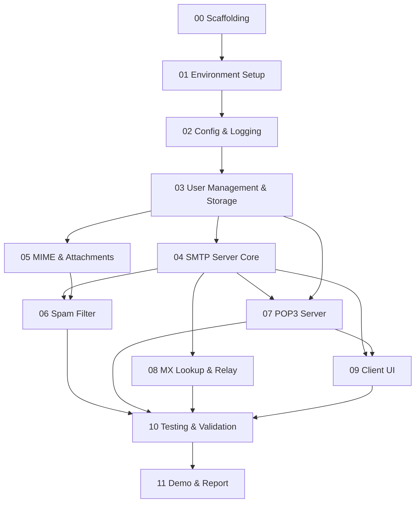

# Implementation Plan — Overview

See [index.md](../index.md) for full requirements, [architecture.md](../architecture.md) for system design, and [log.md](../log.md) for current state.

---

## Step Table

| # | Title | Depends On | Estimated Effort | Status |
|---|-------|-----------|-----------------|--------|
| 00 | Scaffolding & Documentation | — | 2–3 h | ✅ Done |
| 01 | Environment Setup | 00 | 30 min | [ ] |
| 02 | Config & Logging | 01 | 1 h | [ ] |
| 03 | User Management & Storage | 02 | 2–3 h | [ ] |
| 04 | SMTP Server Core | 03 | 4–5 h | [ ] |
| 05 | MIME & Attachments | 03 | 2 h | [ ] |
| 06 | Spam Filter | 04, 05 | 1–2 h | [ ] |
| 07 | POP3 Server | 03, 04 | 3–4 h | [ ] |
| 08 | MX Lookup & Relay | 04 | 2 h | [ ] |
| 09 | Client UI | 04, 07 | 3–4 h | [ ] |
| 10 | Testing & Validation | 04–09 | 3 h | [ ] |
| 11 | Demo & Report | 10 | 2–3 h | [ ] |

---

## Dependency Graph

---

## Rules for Working Through the Plan

1. **Read `docs/log.md` first** (Current State + latest 10 entries) at the start of every session.
2. **One step at a time.** Complete prerequisites before starting the next step.
3. **Tick the checkbox** in this table and in the step file when done.
4. **Update `docs/log.md`** at the end of every session.
5. **No protocol library shortcuts** — SMTP/POP3 server logic is hand-written.
6. **Tests ship with the feature** — write or update tests in the same step.
